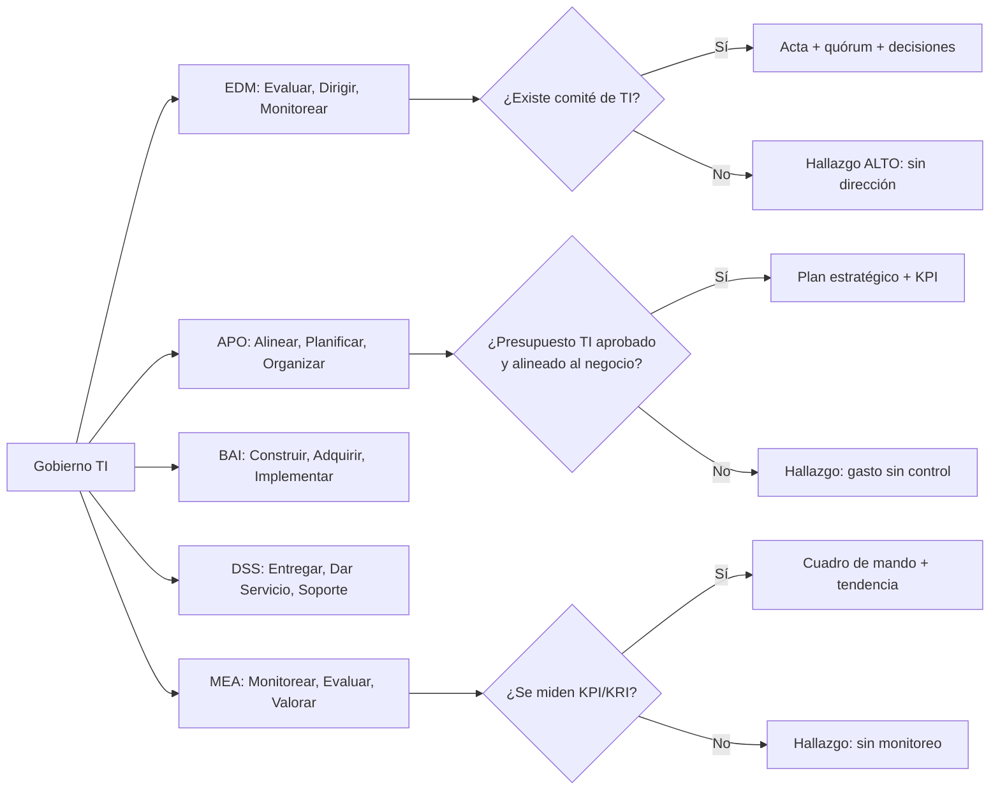
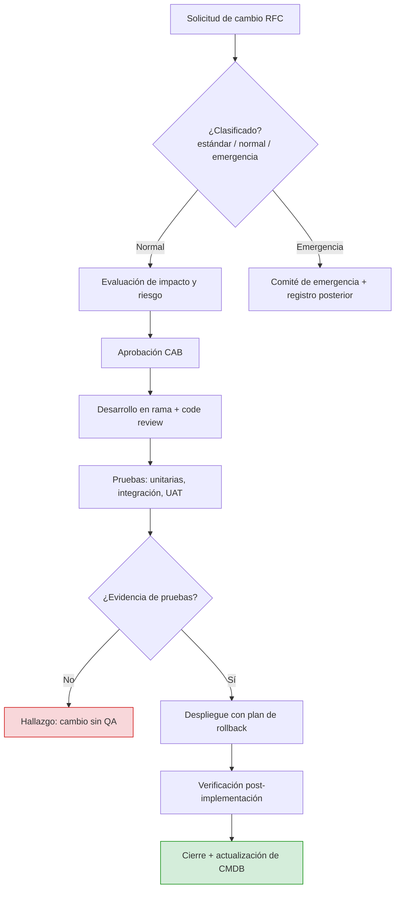
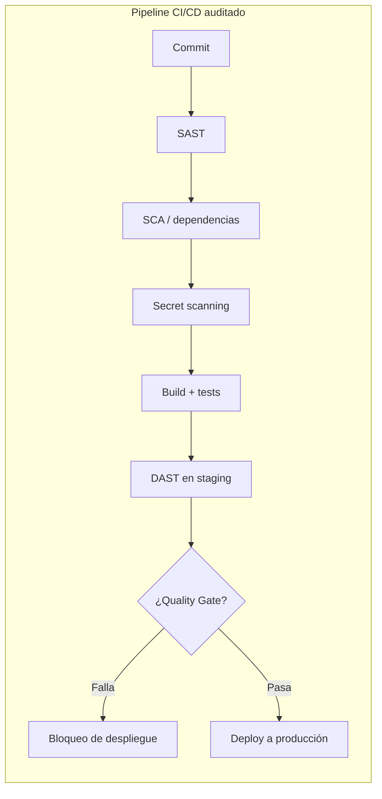
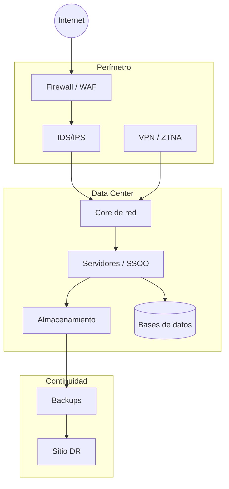
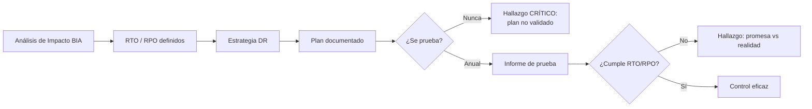
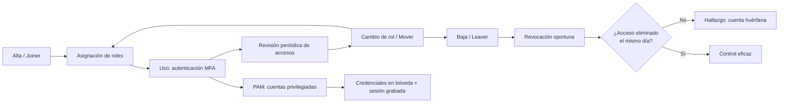
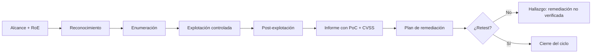
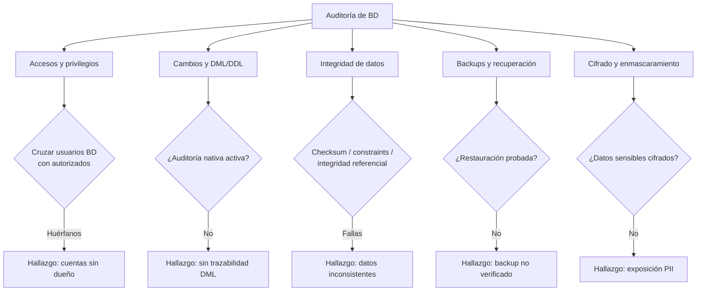

# Áreas Específicas de Auditoría Informática

> **Enfoque de este documento:** no se explican los conceptos (se asume que ya se conocen), sino **cómo auditarlos**: qué evidencias pedir, qué pruebas ejecutar, qué herramientas usar, qué hallazgos suelen aparecer y cómo se documentan.

---

## 0. Marco común para auditar cualquier área

Antes de entrar en cada dominio, conviene fijar un método homogéneo. Toda auditoría informática se apoya en cuatro pilares:

| Pilar | Qué implica | Evidencia típica |
|---|---|---|
| **Cumplimiento normativo** | ¿Se cumple la política, el estándar, la ley? | Políticas firmadas, matrices de cumplimiento, ISO 27001/COBIT |
| **Eficacia del control** | ¿El control realmente mitiga el riesgo? | Pruebas de control, muestras, logs, resultados de escaneo |
| **Diseño vs. operación** | ¿El control está bien diseñado y además se ejecuta? | Documentación vs. registros reales (tickets, logs, actas) |
| **Evidencia suficiente y competente** | ¿La conclusión se sostiene? | Fuentes independientes, trazabilidad, cadena de custodia |

### Técnicas de auditoría aplicables a todas las áreas

- **Entrevista**: con responsables de proceso (CIO, CISO, DBA, jefe de infraestructura).
- **Revisión documental**: políticas, procedimientos, matrices RACI, actas de comité.
- **Observación directa**: recorrido por el data center, revisión en vivo de consolas.
- **Prueba de cumplimiento (walkthrough)**: reproducir un proceso de punta a punta.
- **Prueba sustantiva**: verificar el dato/registro final (ej. comparar altas de usuarios con RRHH).
- **Muestreo**: aleatorio, estratificado o por atributos; definir tamaño y población.
- **CAAT (Computer Assisted Audit Techniques)**: scripts, consultas SQL, análisis de logs.
- **Recalculo / reejecución**: repetir un cálculo o control de forma independiente.
- **Análisis de datos**: cruces, detección de duplicados, outliers, reglas de negocio.

### Escala de hallazgos (para clasificar resultados)

| Severidad | Criterio | Ejemplo |
|---|---|---|
| **Crítica** | Riesgo inminente de pérdida o incumplimiento legal | Credenciales de admin en texto plano |
| **Alta** | Control clave ausente o inoperante | Sin revisión de accesos privilegiados |
| **Media** | Control parcial o inconsistente | Backups sin prueba de restauración |
| **Baja** | Mejora de eficiencia o higiene | Documentación desactualizada |

---

## 1. Gobierno TI

### Concepto corto
Conjunto de estructuras, procesos y mecanismos de decisión que alinean la TI con el negocio, gestionan el riesgo y optimizan el valor.

### Cómo auditarlo
El auditor de Gobierno TI no audita "tecnología", audita **decisiones y rendición de cuentas**. Se apoya en tres marcos:

- **COBIT 2019** → evaluación de procesos (EDM, APO, BAI, DSS, MEA).
- **ISO/IEC 38500** → responsabilidad, estrategia, adquisición, desempeño, conformidad, comportamiento humano.
- **ITIL 4** → gestión de servicios y valor.

**Enfoque práctico:** seleccionar los procesos COBIT relevantes según materialidad, calificar su capacidad (0–5) y contrastar con evidencia.

### Puntos clave a verificar
- Existencia y **funcionamiento real** del comité de TI / comité de riesgos (no solo constitución).
- **Alineación estratégica**: plan de TI vs. plan de negocio; portafolio de proyectos priorizado.
- **Presupuesto y control de gasto**: aprobaciones, desviaciones, proveedores.
- **Estructura de decisión**: RACI, segregación de funciones, delegación de autoridad.
- **Gestión de riesgos TI**: registro de riesgos, apetito de riesgo, tratamiento.
- **Métricas**: KPI de servicio, KRI de riesgo, tablero ejecutivo, revisión periódica.
- **Tercerización**: contratos, SLA, cláusulas de auditoría y salida.

### Casos concretos
1. **Comité "de papel"**: existe acta de constitución pero no hay actas de reunión de los últimos 12 meses → control diseñado pero no operativo. Se concluye inoperancia, no ausencia.
2. **Proyecto faraónico**: se aprueba un ERP sin caso de negocio ni análisis costo-beneficio → hallazgo de gobierno sobre adquisición (BAI).
3. **Presupuesto paralelo**: gasto en cloud pagado con tarjeta corporativa fuera del presupuesto de TI → riesgo de fuga de control y shadow IT.

### Herramientas
- **COBIT Toolkit / ISACA**, plantillas de madurez.
- **ServiceNow / Jira** para evidenciar portafolio y flujos de aprobación.
- **Power BI / Tableau** para reproducir el cuadro de mando y validar cifras.
- **Excel/CSV + SQL** para cruzar presupuesto vs. facturación de proveedores.

### Evidencias a solicitar
Organigrama, actas de comité, plan estratégico TI, presupuesto y ejecución, registro de riesgos, contratos de outsourcing, tablero de KPI.

---

## 2. Metodologías SDLC/Agile y Gestión de Cambios

### Concepto corto
SDLC: ciclo de vida de desarrollo (requerimientos → diseño → construcción → pruebas → despliegue → mantenimiento). Agile: entrega iterativa e incremental. Gestión de cambios: control formal de toda modificación a producción.

### Cómo auditarlo
El objetivo es verificar que **cada cambio es autorizado, probado, aprobado, trazable y reversible**. Se audita el proceso y se muestrea el registro real.

**Puntos de control del auditor:**

| Etapa | Qué probar | Evidencia |
|---|---|---|
| Solicitud | ¿Toda modificación tiene RFC? | Tickets vs. commits en repositorio |
| Aprobación | ¿Quién aprobó y con qué rol? | Firma / registro en herramienta |
| Segregación | ¿Quien desarrolla es quien despliega? | Roles en Git/CI-CD |
| Pruebas | ¿Hay UAT y resultados? | Casos de prueba, evidencias |
| Despliegue | ¿Ventana, plan de rollback? | Runbook, bitácora |
| Trazabilidad | ¿RFC ↔ commit ↔ despliegue? | Enlaces en Jira/GitLab |

### SDLC tradicional (Waterfall)
- Verificar **entregables por fase** y gates de aprobación (GATE reviews).
- Revisar **matriz de trazabilidad de requerimientos** (requerimiento → diseño → prueba).
- Comprobar **gestión de cambios de alcance** (change requests documentados).

### Agile / Scrum
- Auditar **Definition of Done** y que las historias tengan criterios de aceptación.
- Verificar que **seguridad no quede fuera del sprint** (security stories, threat modeling).
- Revisar **velocidad y deuda técnica** (¿se sacrifica calidad por velocidad?).
- En **DevSecOps**: validar que los controles de seguridad estén **automatizados en el pipeline** (SAST, DAST, SCA, secret scanning).

### Gestión de cambios: pruebas específicas
- **Cambios no autorizados**: comparar cambios en producción (fecha/hora) con RFC aprobados en la misma ventana. Los "fantasma" son hallazgo crítico.
- **Cambios de emergencia**: verificar que existan y se **regularicen después** (no que se usen como norma).
- **Acceso directo a producción**: buscar accesos de desarrolladores a BD/servidores productivos; debe estar restringido y monitoreado.
- **Segregación de funciones**: el que pide, aprueba, desarrolla y despliega no debe ser la misma persona en cambios críticos.

### Casos concretos
1. **"Funciona en mi máquina"**: se despliega un hotfix sin pruebas y tumba el servicio. Al auditar se descubre que el pipeline no tenía gate de pruebas → hallazgo de diseño de control.
2. **Commit directo a main**: desarrollador con permisos de push directo salta el code review. Se detecta comparando políticas de rama con historial de Git.
3. **Cambio de emergencia crónico**: 60% de los cambios son "emergencia"; el proceso normal es la excepción → indica proceso mal dimensionado o abuso.
4. **Dependencia vulnerable**: se introduce una librería con CVE crítica porque no hay SCA en el pipeline. Se demuestra con el SBOM y el escaneo.

### Herramientas
- **Jira / Azure DevOps / ServiceNow** (RFC, aprobaciones, trazabilidad).
- **Git / GitLab / GitHub / Bitbucket** (ramas protegidas, code review, historial).
- **Jenkins / GitLab CI / GitHub Actions / ArgoCD** (pipelines, gates).
- **SonarQube, Checkmarx, Snyk, Trivy, OWASP Dependency-Check** (SAST/SCA).
- **OWASP ZAP / Burp** (DAST).
- **CMDB** para validar inventario y relación cambio–activo.

### Evidencias a solicitar
Política de gestión de cambios, matriz de aprobadores, muestra de RFC con sus commits, resultados de pruebas, logs del pipeline, historial de Git, plan de rollback.

---

## 3. Infraestructura

Comprende cuatro subáreas que se auditan con lógicas distintas pero conectadas: **Data Center**, **DRP/BCP**, **Sistemas Operativos** y **Redes/Perímetro**.

### 3.1 Data Center

**Concepto corto:** instalación que aloja infraestructura crítica con controles físicos y ambientales.

**Cómo auditarlo:** combinar **revisión documental + inspección física + pruebas de monitoreo**. El estándar de referencia es **ANSI/TIA-942** y los niveles **Tier I–IV de Uptime Institute**.

| Control | Prueba del auditor |
|---|---|
| Acceso físico | Revisar bitácora de ingresos vs. autorizados; probar lector de tarjeta/huella |
| Control ambiental | Verificar temperatura/humedad, sensores, registros históricos |
| Energía | Revisar UPS, generador, pruebas de transferencia, autonomía |
| Incendio | Comprobar supresión (agente limpio), detectores, mantenimiento vigente |
| Cableado | Orden, etiquetado, redundancia de rutas |
| Segregación | Pasillos calientes/fríos, jaulas, CCTV con retención |
| Mantenimiento | Contratos y bitácoras de mantenimiento preventivo |

**Caso concreto:** el registro de acceso muestra 40 ingresos de un proveedor de limpieza en horario nocturno sin ticket de trabajo asociado → riesgo de acceso no justificado. Se cruza bitácora física con órdenes de servicio.

**Herramientas:** sistemas de control de acceso (Lenel, Honeywell), DCIM (Sunbird, Device42), sensores ambientales (APC, Vertiv), CCTV.

### 3.2 DRP / BCP

**Concepto corto:** BCP mantiene el negocio operando; DRP recupera la tecnología tras un desastre. Se dimensionan por **RTO** (tiempo de recuperación) y **RPO** (pérdida de datos tolerable).

**Cómo auditarlo:** el error común es auditar el *documento*. Hay que auditar la **capacidad real de recuperación**.

**Puntos clave:**
- **BIA vigente** que justifique RTO/RPO por proceso crítico.
- **Pruebas de recuperación** documentadas y recientes (no solo "tabletop", también técnica).
- **Replicación / backups** fuera de sitio y con verificación de restauración.
- **Roles y contactos** actualizados; activación del plan probada.
- **Dependencias de terceros** (cloud, proveedores) contempladas.

**Caso concreto:** el plan declara RTO de 4 h, pero la última prueba real tardó 14 h porque el backup estaba en cinta y no había personal entrenado. Hallazgo: **brecha entre RTO declarado y RTO demostrado**. Se documenta con el informe de la prueba.

**Herramientas:** Veeam, Commvault, Azure Site Recovery, AWS Elastic Disaster Recovery, plantillas BIA (ISO 22301), herramientas de tabletop.

### 3.3 Sistemas Operativos (SSOO)

**Concepto corto:** capa base donde corren servicios; su hardening y parcheo determinan gran parte de la superficie de ataque.

**Cómo auditarlo:** evaluación de **configuración (hardening)** contra un benchmark y verificación de **gestión de parches**.

| Control | Prueba |
|---|---|
| Hardening | Escaneo contra **CIS Benchmark** / DISA STIG; comparar con línea base |
| Parches | Antigüedad de parches vs. SLA; CVEs abiertos por severidad |
| Cuentas | Usuarios locales, cuentas huérfanas, cuentas de servicio, root/Administrator |
| Servicios | Puertos y servicios innecesarios expuestos |
| Logs | Reenvío a SIEM, retención, integridad |
| Antimalware | Cobertura, firmas actualizadas, exclusiones justificadas |
| Configuración | NTP, DNS, SELinux/AppArmor, contraseñas, SSH |

**Caso concreto:** servidor Linux con `PermitRootLogin yes`, SSH en puerto 22 expuesto a Internet y kernel sin parches de hace 18 meses → combinación de hallazgos que eleva la severidad global.

**Herramientas:** **CIS-CAT**, **OpenSCAP**, **Lynis**, **Nessus/Qualys** (config assessment), **Ansible/Puppet/Chef** (drift de configuración), **WSUS/Red Hat Satellite/Intune** (parcheo).

### 3.4 Redes y Perímetro

**Concepto corto:** conjunto de controles que segmentan, filtran y monitorean el tráfico entre zonas de confianza y el exterior.

**Cómo auditarlo:** validar **diseño (segmentación, DMZ)** y **operación (reglas, monitoreo)**. La pregunta central: *¿el tráfico permitido es el mínimo necesario?*

**Puntos clave:**
- **Reglas de firewall**: reglas "any-any", obsoletas, sin dueño, sin justificación. Revisar y muestrear.
- **DMZ**: servicios expuestos aislados de la red interna.
- **Segmentación**: VLANs, microsegmentación, separación de ambientes (prod/dev).
- **IDS/IPS**: cobertura, firmas actualizadas, alertas atendidas.
- **VPN / acceso remoto**: MFA, cifrado, cuentas, split tunneling.
- **Wi-Fi**: WPA3/Enterprise, segmentación de invitados, rogue AP.
- **Gestión de dispositivos**: inventario, firmware, fin de soporte (EOL).

**Caso concreto:** se detecta una regla `permit any any` creada "temporalmente" hace 3 años para una prueba; nadie la retiró. El análisis de flujo muestra tráfico interno→Internet no filtrado. Hallazgo alto con evidencia de la regla y su fecha.

**Herramientas:** **Nmap** (descubrimiento), **Nessus/Qualys/OpenVAS** (vulnerabilidades), **Wireshark/tcpdump** (captura), **FireMon/Algosec/Tufin** (análisis de reglas), **Zeek/Suricata** (IDS), **Cisco DNA / Aruba ClearPass** (NAC).

---

## 4. Ciberseguridad

### 4.1 IAM (Gestión de Identidades y Accesos)

**Concepto corto:** conjunto de procesos que aseguran que la persona correcta accede al recurso correcto, en el momento correcto, con el mínimo privilegio.

**Cómo auditarlo:** auditar el **ciclo de vida completo** de la identidad y el **principio de mínimo privilegio**.

**Pruebas clave:**
- **Joiner–Mover–Leaver**: cruzar altas/bajas de RRHH con altas/bajas en el directorio (AD/LDAP/IdP). Cuentas activas de personas ya desvinculadas = hallazgo.
- **Mínimo privilegio**: listar miembros de grupos admin/Domain Admins; detectar privilegios acumulados ("privilege creep").
- **Revisión de accesos (access review)**: ¿existe? ¿se ejecuta? ¿el revisor realmente revisa o aprueba todo en bloque?
- **MFA**: cobertura por aplicación crítica; excepciones justificadas.
- **PAM**: bóveda de credenciales, rotación, grabación de sesiones, aprobación de acceso just-in-time.
- **Segregación de funciones (SoD)**: matrices de conflicto (ej. crear proveedor + pagar).
- **Contraseñas**: política, bloqueo, expiración, cuentas de servicio.

**Caso concreto:** la nómina reporta 120 bajas en el año; el directorio muestra 17 cuentas aún activas de ex-empleados, 3 de ellas con acceso a correo. Se documenta el cruce como evidencia y se cuantifica la exposición.

**Herramientas:** **SailPoint / Saviynt / Okta / Azure AD (Entra ID)**, **CyberArk / BeyondTrust / HashiCorp Vault** (PAM), **BloodHound** (rutas de ataque en AD), scripts de conciliación RRHH–AD.

### 4.2 Criptografía

**Concepto corto:** uso de algoritmos y gestión de claves para proteger confidencialidad, integridad y autenticidad.

**Cómo auditarlo:** el foco no es "¿hay cifrado?" sino **qué algoritmo, cómo se gestionan las claves y dónde están**.

| Aspecto | Prueba |
|---|---|
| Algoritmos | Detectar MD5/SHA-1/DES/RC4/TLS 1.0-1.1 obsoletos |
| En tránsito | Escaneo TLS (versiones, cifrados, certificados) |
| En reposo | Cifrado de discos, BD, backups |
| Claves | Dónde se almacenan, quién accede, rotación, separación |
| Certificados | Vigencia, cadena, revocación, claves privadas protegidas |
| HSM/KMS | Uso, configuración, respaldo de claves |

**Caso concreto:** la aplicación usa TLS 1.2, pero el servidor de base de datos guarda contraseñas con MD5 sin sal. El "cifrado existe" pero es criptográficamente inútil. Se evidencia con la consulta a la tabla y el análisis del hash.

**Herramientas:** **testssl.sh / sslyze / Qualys SSL Labs**, **OpenSSL**, **Hashcat/John the Ripper** (verificar fortaleza de hashes en auditoría autorizada), **AWS KMS / Azure Key Vault / HashiCorp Vault**, **HSM** (Thales, Utimaco).

### 4.3 Ethical Hacking / Pentesting

**Concepto corto:** prueba de intrusión autorizada que simula a un atacante para validar la seguridad real de un sistema.

**Cómo auditarlo (auditar el pentest, no hacerlo):** evaluar si el ejercicio fue **metodológicamente sólido, dentro de alcance y con remediación verificada**.

**Puntos clave:**
- **Alcance y autorización**: contrato, reglas de engagement, ventana, sistemas incluidos/excluidos.
- **Metodología**: PTES, OWASP Testing Guide, MITRE ATT&CK, NIST SP 800-115.
- **Cobertura**: caja negra/gris/blanca, capas (red, app, social, físico).
- **Evidencia**: capturas, PoC reproducibles, CVSS, no solo "encontramos X".
- **Remediación**: ¿se corrigió? ¿se **re-testeó**? Un informe sin retest es un control incompleto.
- **Confidencialidad**: manejo del informe, datos sensibles, destrucción de artefactos.

**Caso concreto:** el informe lista 30 vulnerabilidades, pero 12 siguen abiertas al año siguiente y no hubo retest. Se concluye que el pentest se usó como requisito de cumplimiento, no como mejora real.

**Herramientas:** **Burp Suite / OWASP ZAP**, **Metasploit**, **Nmap**, **Nikto**, **sqlmap**, **BloodHound**, **Impacket**, **Cobalt Strike** (en ejercicios autorizados), frameworks de reporte (Dradis, PlexTrac).

---

## 5. Auditoría de Bases de Datos e Integridad

### Concepto corto
Verificar que los datos son **íntegros, confidenciales y disponibles**, y que los accesos y cambios están controlados y auditados.

### Cómo auditarla
Se auditan cinco dimensiones: **accesos, cambios, integridad, disponibilidad (backups) y protección (cifrado/masking)**.

### Puntos clave y pruebas

| Dimensión | Prueba concreta | Evidencia |
|---|---|---|
| **Accesos** | Listar usuarios/roles/privilegios; detectar DBA compartido, cuentas genéricas, `PUBLIC` con permisos | Consultas al diccionario de datos |
| **Cambios** | Activar/revisar auditoría nativa (DDL y DML); buscar updates directos en prod | Logs de auditoría, triggers |
| **Integridad** | Verificar constraints, FKs, checksums, duplicados, huérfanos, rangos | Consultas de validación |
| **Disponibilidad** | Restaurar backup en entorno aislado y comparar | Informe de restauración |
| **Protección** | Cifrado TDE/columnas, masking en no-prod, TDE de backups | Configuración + muestreo |
| **Segregación** | ¿El DBA puede alterar datos sin dejar rastro? | Separación de roles y auditoría |

**Casos concretos:**
1. **Cambio directo en producción**: se detecta que un analista ejecutó `UPDATE salarios SET ...` sin ticket ni aprobación. Se evidencia con el log de auditoría (si existe) o se concluye la **imposibilidad de evidenciar** por falta de auditoría → doble hallazgo.
2. **Datos huérfanos**: tabla de pedidos con `cliente_id` que no existe en clientes (FK deshabilitada "por rendimiento"). Se cuantifica con `LEFT JOIN ... WHERE cliente_id IS NULL`.
3. **Backup que no restaura**: el job reporta "éxito" pero la restauración falla por corrupción. Se demuestra restaurando en un entorno de prueba.
4. **PII sin enmascarar en desarrollo**: copia de producción en ambiente de pruebas con datos reales de tarjetas → incumplimiento grave de protección de datos.
5. **DBA con demasiado poder**: una sola cuenta administra BD, backups y auditoría; puede borrar sus propias huellas → violación de segregación.

**Herramientas:**
- **Auditoría nativa**: Oracle Audit Vault / Unified Auditing, SQL Server Audit, MySQL Enterprise Audit, **pgAudit** (PostgreSQL).
- **Monitoreo de actividad**: **Imperva**, **IBM Guardium**, **Datadog Database Monitoring**.
- **Descubrimiento de datos sensibles**: **AWS Macie**, **Microsoft Purview**, **data discovery** de Guardium/Imperva.
- **Integridad**: scripts SQL, **dbForge**, **Redgate**, checksums (`DBCC CHECKDB`, `pg_checksums`).
- **Backups**: RMAN, pgBackRest, SQL Server Backup, Veeam; pruebas de restauración.
- **Enmascaramiento**: **Delphix**, **Redgate Data Masker**, generadores de datos sintéticos.

### Evidencias a solicitar
Diccionario de datos, matriz de roles y privilegios, configuración de auditoría, logs de auditoría, resultados de validación de integridad, informes de restauración, configuración de cifrado, inventario de datos sensibles.

---

## 6. Matriz de herramientas por área (resumen)

| Área | Herramientas destacadas |
|---|---|
| Gobierno TI | COBIT, ServiceNow, Power BI, Jira |
| SDLC / Cambios | Jira, GitLab, Jenkins, SonarQube, Snyk, OWASP ZAP |
| Data Center | DCIM (Device42), control de acceso, sensores ambientales |
| DRP/BCP | Veeam, Commvault, ASR, plantillas ISO 22301 |
| SSOO | CIS-CAT, OpenSCAP, Lynis, Nessus, Ansible |
| Redes/Perímetro | Nmap, FireMon, Wireshark, Zeek/Suricata, Nessus |
| IAM | SailPoint, Okta, CyberArk, BloodHound |
| Criptografía | testssl.sh, sslyze, Vault, KMS, Hashcat |
| Ethical Hacking | Burp, ZAP, Metasploit, sqlmap, PlexTrac |
| BD e integridad | pgAudit, Guardium, Imperva, Redgate, RMAN |

---

## 7. Checklist transversal de cierre

- [ ] ¿Cada hallazgo tiene **criterio** (norma/política), **condición** (lo observado), **causa**, **efecto** y **recomendación**?
- [ ] ¿La evidencia es **suficiente, competente y trazable** (fuente, fecha, responsable)?
- [ ] ¿Se distinguió entre control **inexistente**, **mal diseñado** e **inoperante**?
- [ ] ¿Se verificó la **remediación** de hallazgos anteriores (seguimiento)?
- [ ] ¿Se protegió la **confidencialidad** de la evidencia (datos sensibles, accesos)?
- [ ] ¿Se documentaron las **limitaciones de alcance** (ej. no se pudo probar restauración)?

---

> **Idea fuerza:** en auditoría informática el valor no está en describir la tecnología, sino en demostrar con evidencia si los controles **existen, están bien diseñados y operan de forma sostenida**. Cada área se audita con la misma disciplina: criterio → prueba → evidencia → conclusión.
